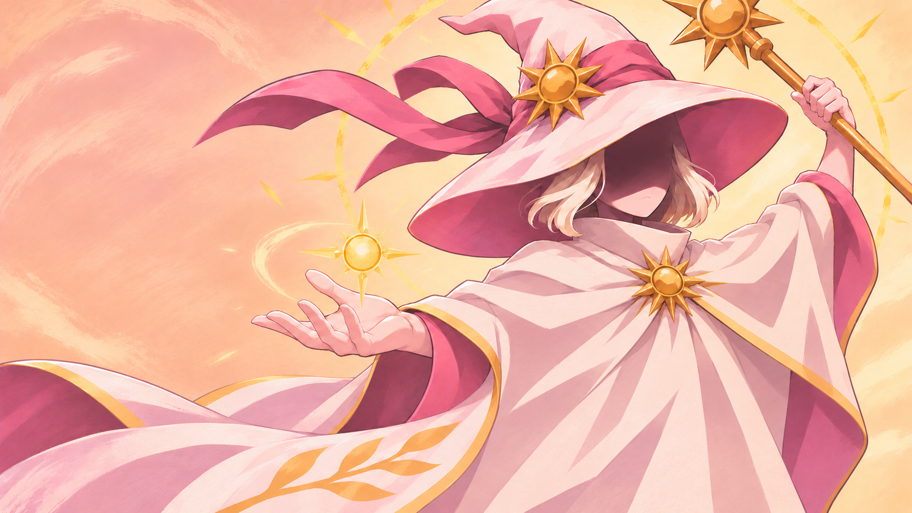

# 深深当前形象定稿

## 唯一视觉基准

2026-11-07，用户在弱化性别特征的 A「隐面旅者」基础上确认圆润下半脸与指定淡唇，最终回复「可以，就决定这张，请实装，然后先将这张固定为深深的形象」。

**当前人形视觉以这张最终确认图为准：**

- 正式文件：`Shenshen/images/character_select/apricot-dawn-gold/background.png`，1672×941。
- 固定版本 ID：`mystery-roundface-soft-lips-v1`。
- SHA256：`C7544FDCB9BD69C16057F8FF25DAF1DC3DBC60107BA25C9DC2936D596DA62F75`。
- 配色沿用 **杏桃晨金**，定义见 [配色参考](art-style-apricot-dawn-gold.md)。

后续引用此文件与版本 ID，不再仅使用「第 2／3 版」等在展示顺序中可能混淆的编号。图像优先于文字形容，不能根据「圆润」等词重新生成一张相似脸来替代。

## 固定的外形特征

- **弱化性别轮廓**：高领、宽松闭合的奶油白斗篷覆盖胸腹，从肩部连续垂落，不强调胸腰髋体块，不恢复贴身粉色胸衣或收腰剪裁。
- **圆润下半脸**：以下半脸参考附件 `052c98e3` 为底图，保留用户最终确认的较短、较宽、柔和下缘；不要改回此前偏窄长或尖下巴。
- **指定淡唇**：唇形来自参考附件 `2bf0319a`，同坐标原像素复制 `[1164,356,34,16]`。嘴唇与参考像素一致，该区域之外与最终脸型参考像素一致；不使用生成式重绘冒充完全相同。
- **遮脸与发色**：帽影仍遮住眉眼鼻，只露圆润下半脸和极淡嘴唇；少量奶油白金短发，白皙肤色，不新增睫毛、眼睛、鼻尖或浓唇色。
- **标志元素**：太阳宽檐帽、粉色帽带、太阳胸针、金色太阳法杖、粉白金斗篷与金色叶纹保持。
- **已确认 pose**：一手向左前方伸出托起太阳光，另一手举杖，身体微侧，斗篷与帽带展开。当前定稿不调整手位、握点、头部角度或整体构图。

## 本轮接入与后续范围

本轮接入选人背景及从同图原像素裁取的 440×650 小卡面，固定此图作为之后制作深深形象的参照。小卡面取景 `[946,0,440,650]`，与官方 132:195 比例相同，不另画一张相似脸。

用户提到之后会调整卡牌风格；本轮不批量重绘卡图，也不改变卡牌数值、形态或玩法。现有战斗全身动画、HUD／地图头像及商店角色仍沿用此前 B5 资源，它们与本张半身定稿的全身造型适配另行制作和验证，不能将本轮选人接入表述为全游戏形象已完全同步。

猫形态继续使用此前确认的幼猫，不因本次人形定稿改变。后续调整卡图时以本页的外形、[杏桃晨金配色](art-style-apricot-dawn-gold.md)、太阳元素和手绘色块为共同依据；具体卡图改动按后续要求推进。
